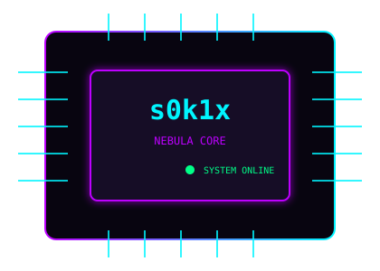

<div align="center">


`[ SYSTEM INITIALIZED ]` · `[ ACCESS: GRANTED ]` · `[ MODE: EXPERIMENTAL ]`

</div>

---

## `01 // WHOAMI`

```text
┌──────────────────────────────────────────────────────┐
│ USER       : s0k1x                                   │
│ FIELD      : Cybersecurity                           │
│ FOCUS      : Ethical Hacking / Scripting             │
│ ENV        : Linux                                   │
│ DIRECTIVE  : Learn • Build • Experiment              │
└──────────────────────────────────────────────────────┘
```

I'm interested in **cybersecurity, ethical hacking, automation, scripting, and Linux**. I enjoy exploring how systems work, building useful tools, and learning through practical projects.

```bash
$ whoami
s0k1x
$ cat mission.txt
Learn continuously.
Build useful things.
Understand systems.
Experiment responsibly.
```

## `02 // TOOLKIT`

<div align="center">


</div>

## `03 // REPOSITORY SCANNER`

<!-- AUTO-GENERATED:START -->
| Repository | Language | Stars | Updated (UTC) |
|---|---:|---:|---|
| [IA-WEB](https://github.com/s0k1x/IA-WEB) | — | ⭐ 0 | — |
| [kreskolab](https://github.com/s0k1x/kreskolab) | — | ⭐ 0 | — |
| [malaga-checkout](https://github.com/s0k1x/malaga-checkout) | — | ⭐ 0 | — |
| [Malaga-reventa](https://github.com/s0k1x/Malaga-reventa) | — | ⭐ 0 | — |
| [PELUQUERIA-JUANMA-BARBERIA](https://github.com/s0k1x/PELUQUERIA-JUANMA-BARBERIA) | — | ⭐ 0 | — |
| [PEQUE-m](https://github.com/s0k1x/PEQUE-m) | — | ⭐ 0 | — |
| [Roblox-automatico](https://github.com/s0k1x/Roblox-automatico) | — | ⭐ 0 | — |
| [s0k1x](https://github.com/s0k1x/s0k1x) | Markdown | ⭐ 0 | — |
| [s0k1x-toolkit](https://github.com/s0k1x/s0k1x-toolkit) | — | ⭐ 0 | — |
| [unuvia](https://github.com/s0k1x/unuvia) | — | ⭐ 0 | — |
<!-- AUTO-GENERATED:END -->

[](https://github.com/s0k1x?tab=repositories)

## `04 // SYSTEM STATUS`

<!-- STATUS:START -->
> **Last profile update:** awaiting first workflow run.
<!-- STATUS:END -->


## `05 // S0K1X ARCADE`

<div align="center">

[](https://s0k1x.github.io/s0k1x/)

**CYBER SNAKE // NEON PROTOCOL**  
Collect data fragments. Avoid collisions. Beat your high score.

</div>

> The game is deployed from `/arcade` with GitHub Pages. Enable Pages in **Settings → Pages → Build and deployment → GitHub Actions**.

## `06 // SYSTEM CORE`

<div align="center">



</div>

## `07 // GITHUB ANALYTICS`

<div align="center">


</div>

## `08 // DIRECTIVE`

```python
class S0K1X:
    focus = ["Cybersecurity", "Ethical Hacking", "Linux", "Python", "Automation"]
    mode = "EXPERIMENTAL"

    def next_step(self):
        return "LEARN -> BUILD -> TEST -> IMPROVE"
```

<div align="center">

### `THINK — EXPERIMENT — EVOLVE`


`[ END OF TRANSMISSION // s0k1x ]`

</div>
